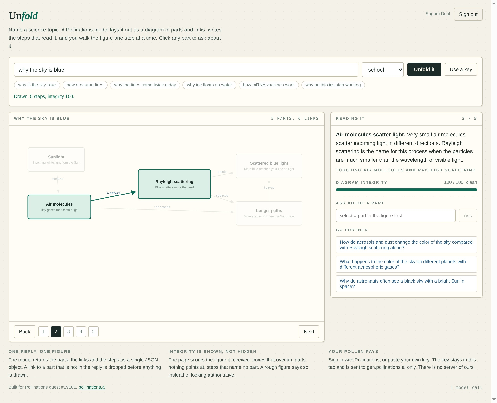

# Unfold

[](https://pollinations.ai/?ref=badge)

A science topic in, an interactive diagram out. One Pollinations model call returns
the parts, the links between them and the steps that read the figure. Click a step and
the drawing lights the parts it is about; click a part and you can ask about it.

Live app: https://sugamdeol.github.io/unfold/



## What it does

Type a topic ("why is the sky blue", "how a neuron fires"), pick a reader level, press
**Unfold it**. The model replies with one JSON object:

```json
{
  "title": "Why the sky is blue",
  "blurb": "short wavelength light scatters far more in air",
  "nodes": [{ "id": "sunlight", "label": "Sunlight", "role": "all colours at once",
              "x": 80, "y": 60, "w": 180, "h": 90 }],
  "links": [{ "from": "sunlight", "to": "molecules", "label": "enters" }],
  "steps": [{ "title": "Light arrives", "detail": "two or three sentences",
              "focus": ["sunlight"] }],
  "further": ["why are sunsets red"]
}
```

`core.js` decides what is allowed on the canvas before anything is drawn:

- boxes are clamped inside the 1000x620 canvas and capped in size;
- overlapping boxes are pushed apart, and the fact that this was needed is noted;
- links that name a part which is not in the reply are dropped and noted;
- ids are made unique, labels and roles are clipped;
- a reply with fewer than two parts, or with no usable steps, is refused outright.

`app.js` draws the result as SVG, draws arrows between box edges rather than centres so
the arrowhead lands on the border, places each link label at the first spot that does not
sit on a box, and lights the parts and links each step names.

## The integrity score

The panel scores every figure out of 100 and lists what cost it points: overlapping
boxes, parts that no step or link touches, steps that point at nothing, a figure with no
links, a box outside the canvas, and any repair the normaliser had to make. A rough
figure says so instead of looking authoritative. That number is the honest part of the
app: a language model proposing a diagram sometimes draws one that does not hold
together, and you get to see that instead of a silent cleanup.

## Your own Pollen pays

Sign in with Pollinations (OAuth code flow with PKCE, public app key
`pk_xvhcmpgSz2sCxeFp`), or paste your own `sk_` key with **Use a key**. The key stays in
this tab's `sessionStorage`, is sent to `gen.pollinations.ai` and nowhere else. There is
no server of ours.

## Run it

Open `index.html`. No build step, no dependencies, no bundler. `core.js` holds the
scene rules, `app.js` the drawing and the OAuth flow, `index.html` the page.

Tests: `node --test core.test.js` (17 tests, no dependencies, Node 18+). They cover
clamping, overlap spreading, duplicate ids, dropped links, refusal of unusable replies,
the integrity arithmetic and the label wrapping.

## Cost per figure

One figure is one chat completion on `openai/gpt-5.4-nano` with about 2.6k output
tokens allowed, which is a fraction of a Pollen. Asking about a part is one short
completion of a few hundred tokens.

## Quest

Built for [Pollinations quest #19181](https://github.com/pollinations/pollinations/issues/19181),
an app that turns a science topic into an interactive visual explanation.
